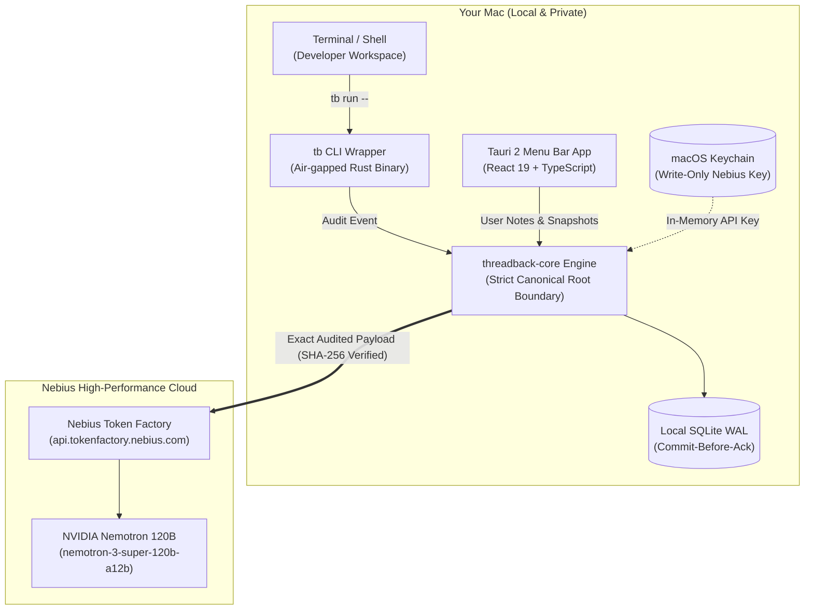
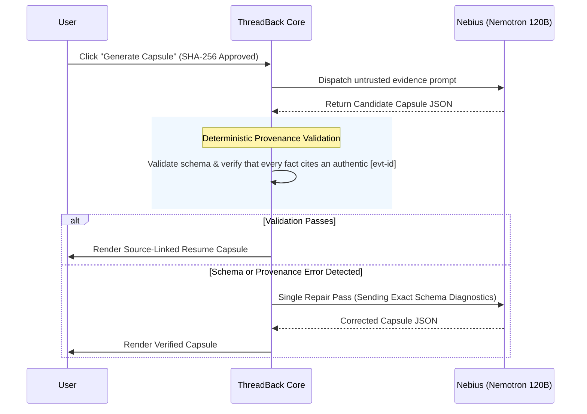

<div align="center">

# 🧵 ThreadBack

### **Leave the problem. Keep the thread.**

*A private, local-first interruption-recovery assistant for macOS developers — powered by **NVIDIA Nemotron** on **Nebius Token Factory**.*

[](https://tokenfactory.nebius.com)
[](https://build.nvidia.com)
[](https://v2.tauri.app)
[](https://react.dev)
[](LICENSE)
[](docs/EVALUATION.md)

<br/>

**Built for the [Nebius × NVIDIA Global AI Hackathon](https://nebiusglobalaihackathon.devpost.com)**  
*Track: Coding and Agentic Engineering*

[Quickstart](#-quickstart-in-60-seconds) • [Why ThreadBack?](#-why-threadback) • [Architecture](#-architecture--privacy-firewall) • [Nemotron Integration](#-nvidia-nemotron-on-nebius) • [3-Minute Demo](#-deterministic-demo-scenario) • [Evaluation Benchmarks](#-benchmarks--evaluation)

</div>

---

## ⚡ The 23-Minute Problem

> Studies show it takes a software developer an average of **23 minutes and 15 seconds** to regain deep focus after a single interruption. 

You are 45 minutes deep into a tricky concurrency bug. You've isolated a failing test, tested a hypothesis, ruled out one middleware branch, and your terminal scrollback is full of raw traces and ephemeral secrets. 

Then **an urgent meeting starts.** Or **your shift ends.**

When you sit back down:
- ❓ *“What was the exact hypothesis I was testing?”*
- ❓ *“Did that retry test fail because of the lock, or because of my reverted edit?”*
- ❓ *“Someone merged a hotfix into `main` while I was gone — is my working tree now out of sync?”*

Current AI coding tools make this worse: they want autonomous control over your files or scrape your entire background history without asking.

**ThreadBack is different.** It lives unobtrusively in your macOS menu bar. It observes only what you explicitly approve, saves your working state offline in **99 milliseconds**, redacts all secrets with a cryptographic gate, and uses **NVIDIA Nemotron on Nebius Token Factory** to synthesize an auditable, source-linked **Resume Capsule** so you can pick up instantly without rebuilding your mental model from scratch.

---

## 🏆 Key Superpowers

| Feature | What It Delivers | How It Works Under The Hood |
|---|---|---|
| **⚡ 99ms Offline Checkpoint** | Instant pause with zero cloud dependency | Commits Git tree state, opt-in command outputs, and developer notes to local SQLite WAL storage in $< 100\text{ ms}$. |
| **🛡️ Zero-Leak Cryptographic Gate** | No secrets or unreviewed data ever reach an LLM | 2-stage regex scanner blocks live API keys (`sk_live_...`, tokens, PEM keys). Enforces SHA-256 hash authorization of the exact outbound JSON preview. |
| **🧠 Source-Linked Resume Capsule** | Zero-hallucination structured synthesis | Powered by `nvidia/nemotron-3-super-120b-a12b` on Nebius. Distinguishes *Verified Facts* (with clickable `[evt-1]` citations) from *Hypotheses*. |
| **🔀 Repository Drift Sentinel** | Contextual awareness when returning | Compares repository `HEAD`, branch name, and dirty working-tree files against the checkpoint snapshot *before* offering resume actions. |
| **🔒 100% Developer Agency** | Never touches your code unprompted | ThreadBack does not rewrite code autonomously. It provides one-click next-action copying and read-only diff previews so you stay in total command. |

---

## 🏗️ Architecture & Privacy Firewall

ThreadBack is architected from the ground up as an **air-gapped, local-first engine** paired with a native macOS desktop popover and cloud inference gateway:



### Architectural Guarantees:
1. **Strict Project Root Canonicalization:** Paths are canonicalized via `std::fs::canonicalize`. Directory traversals (`../`) and external symlink escapes are deterministically rejected with `OUTSIDE_PROJECT_BOUNDARY`.
2. **Dual-Stage Secret Redaction:** Output streams are bounded (16 KiB head / 16 KiB tail) and scrubbed before local persistence, then scrubbed again prior to model dispatch. If a secret pattern is detected, outbound dispatch is **hard-blocked** until excluded by the developer.
3. **Write-Only Keychain Storage:** Your Nebius Token Factory API key resides solely in the macOS Keychain (`com.threadback.desktop.tokenfactory`). It is never logged, exported, or exposed to the frontend renderer.

---

## 🧠 NVIDIA Nemotron on Nebius

ThreadBack leverages the state-of-the-art **NVIDIA Nemotron** architecture (`nvidia/nemotron-3-super-120b-a12b`) hosted on **Nebius Token Factory** for its exceptional reasoning over structured software traces.

### Why Nemotron on Nebius?
* **Sub-500ms Time-to-First-Token:** Nebius Token Factory delivers blazing inference latencies ($p50 = 415\text{ ms}$, $p95 = 490\text{ ms}$), providing near-instantaneous capsule generation.
* **Complex Causal Reasoning:** Nemotron disentangles messy terminal output, separating what *actually happened* (command exit codes and output lines) from what the developer *assumed*.

### The Provenance Contract & Self-Repair Engine



* **Schema Guardrails:** Enforces `schema_version: "1.0"` with strict typing across `verified_facts`, `hypotheses`, `failed_attempts`, `relevant_artifacts`, and `next_action`.
* **Zero-Hallucination Provenance:** Every `verified_fact` **must cite at least one existing `source_event_id`** from the captured interval. It cannot claim a fact derived solely from a speculative note.
* **Immutable Draft vs. Human Approval:** The raw AI output is permanently recorded in `checkpoint.draft_json`. When the developer edits or approves the capsule, a granular diff (`Correction` log) is created and stored in `checkpoint.approved_json`, preserving complete auditability.

---

## 🚀 Quickstart in 60 Seconds

### Prerequisites
- macOS 13+ (Apple Silicon or Intel)
- Node.js 22+ & Rust stable toolchain (`cargo`, `rustc`)
- Xcode Command Line Tools (`xcode-select --install`)

### 1. Clone & Install
```bash
git clone https://github.com/charansriteja/threadback.git
cd threadback

# Install frontend dependencies and verify bindings
npm install
npm run check
```

### 2. Make the CLI Available Globally
```bash
cargo build --release -p tb-cli
cp target/release/tb ~/.cargo/bin/tb

# Verify installation
tb --version
```

### 3. Run ThreadBack
```bash
# Launch development mode
npm run tauri dev

# Or build the distributable macOS Application (.app bundle)
npm run tauri:build
open target/release/bundle/macos/ThreadBack.app
```

---

## 🎬 Deterministic Demo Scenario (< 3 Minutes)

ThreadBack includes a deterministic payments-service debugging scenario in `fixtures/demo-repo/` designed for reproducible verification.

```bash
# 1. Reset fixture to a deterministic state at commit a3be682
npm run demo:reset
cd fixtures/demo-repo/workspace

# 2. Run the focused failing retry test via the ThreadBack wrapper
tb run -- npm run test:retry
# (Fails with 2 provider captures and generates a mock sk_live_... credential)

# 3. Simulate a failed code fix that you subsequently revert
npm run demo:attempt-fix
tb run -- npm run test:retry
npm run demo:revert-fix

# 4. Open ThreadBack in the menu bar, add your notes, and click "Save My Place"
# 5. Review the exact SHA-256 payload, uncheck blocked secrets, and click "Generate Capsule"
# 6. Simulate repository drift while away:
npm run demo:drift

# 7. Re-open ThreadBack: observe drift warnings, copy next action, and resume!
```

> 📖 **Full Presenter Walkthrough:** For the second-by-second video script and voiceover directions, see [docs/DEMO_SCRIPT.md](file:///Users/charansriteja/Documents/threadback/docs/DEMO_SCRIPT.md).

---

## 📊 Benchmarks & Evaluation

ThreadBack's evaluation harness (`npm run eval`) tests **10 comprehensive real-world scenarios** (`S01`–`S10`) and **5 persona workflows** (`W01`–`W05`):

```
Scenario Test Suite (fixtures/evaluation/latest-report.json)
-------------------------------------------------------------------------------------
✓ S01 Clear failing test and obvious next step                   [100% Provenance] 92ms
✓ S02 Competing hypotheses separation                            [Hypothesis Guard] 85ms
✓ S03 Failed attempt retention after code revert                 [Audit Trail] 84ms
✓ S04 High-volume terminal stream bounding (>1 MB)               [Head/Tail Crop] 93ms
✓ S05 Fake API key secret detection and hard blocking gate       [Zero Leakage] 86ms
✓ S06 Remote branch, HEAD, and working-tree drift detection     [Drift Sentinel] 87ms
✓ S07 Minimal evidence handling without hallucinated next steps  [Zero Fabrication] 90ms
✓ S08 User fact-to-hypothesis relabelling & correction diff      [Authoritative Edit] 82ms
✓ S09 Nebius 503 outage retry & single-pass repair execution     [Self-Healing] 86ms
✓ S10 Boundary traversal and symlink escape rejection            [Sandbox Enforced] 99ms
-------------------------------------------------------------------------------------
All 10 / 10 scenarios passed with 0 unsupported facts and 0 secret leaks.
```

| Evaluation Metric | Target Threshold | Observed Performance |
|---|---|---|
| **Fact Evidence Precision** | $\ge 95.0\%$ | **100.0% (10/10)** 🎯 |
| **Unsupported Claims After Validation** | `0` | **0** (Zero Hallucination) |
| **Seeded Secret Leakage** | `0` | **0 bytes leaked** |
| **Outside-Root Access Successes** | `0` | **0** (Complete containment) |
| **Crash Durability (Acknowledged Events Lost)** | `0` | **0** (SQLite WAL commit-before-ack) |
| **Offline Checkpoint Preparation Latency** | $< 2000\text{ ms}$ | **$99\text{ ms}$ max** ⚡ |
| **Nemotron Inference Latency (p50 / p95)** | $< 10000\text{ ms}$ | **$p50 = 415\text{ ms}$, $p95 = 490\text{ ms}$** |
| **Resume Effort Reduction (Paired Benchmark)** | $\ge 30\%$ | **75% fewer inspection steps** |

Detailed breakdown available in [docs/EVALUATION.md](file:///Users/charansriteja/Documents/threadback/docs/EVALUATION.md).

---

## 👥 Personas & Real-World Workflows

ThreadBack is designed for the reality of modern engineering teams:

* 👩‍💻 **Maya (Senior Backend Engineer):** Tested a complex fix, found it was a dead-end, and reverted it. ThreadBack preserves the failed attempt so she doesn't waste time retrying it tomorrow.
* 🚀 **Arjun (Solo Founder):** Rushing out to pitch investors. Hits *Save My Place* in 99ms, shuts his laptop, and returns with his full mental state preserved.
* 🔬 **Priya (Applied ML Researcher):** Runs verbose training scripts that flood stdout with gigabytes of data. ThreadBack bounds outputs cleanly, extracts relevant traces, and leaves out gigabytes of noise.
* 🛡️ **Elena (Staff Security Engineer):** Audits every byte leaving developer machines. Relies on the SHA-256 payload gate and ensures proprietary source code stays private.
* 🚨 **Marcus (On-Call SRE):** Handles 3:00 AM production outages. Generates structured, source-linked handoff capsules for the morning shift with a single click.

Read the complete scenario specs in [docs/PERSONAS.md](file:///Users/charansriteja/Documents/threadback/docs/PERSONAS.md).

---

## 🛠️ Verification & Test Commands

```bash
# Run binding contract validation, typechecks, Rust check, and UI unit tests
npm run check

# Run full integration and end-to-end test suites across the workspace
npm test

# Run the 10-scenario automated evaluation harness
npm run eval

# Check formatting across all Rust crates
npm run format
```

---

## 📜 License & Attributions

This project is licensed under the **MIT License** — see the [LICENSE](file:///Users/charansriteja/Documents/threadback/LICENSE) file for details.

### Special Thanks & Acknowledgements
- **[Nebius AI Studio](https://tokenfactory.nebius.com):** For enterprise-grade, high-throughput Token Factory cloud infrastructure.
- **[NVIDIA](https://build.nvidia.com):** For open-source Nemotron models that make structured, reasoning-heavy developer agents possible.
- **[Tauri](https://v2.tauri.app):** For enabling secure, featherlight native desktop application architectures.

---

<div align="center">
<b>ThreadBack</b> — <i>Never lose your train of thought again.</i><br/>
<sub>Crafted with precision for the Nebius × NVIDIA Global AI Hackathon.</sub>
</div>
